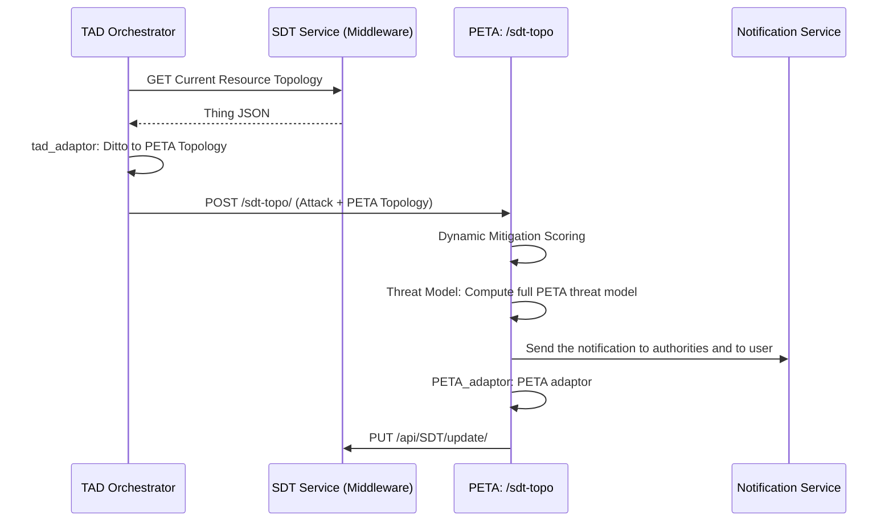
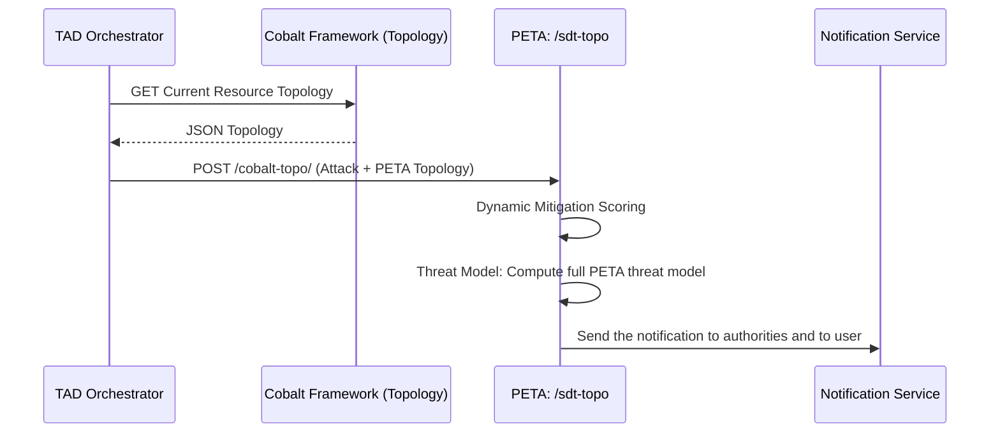
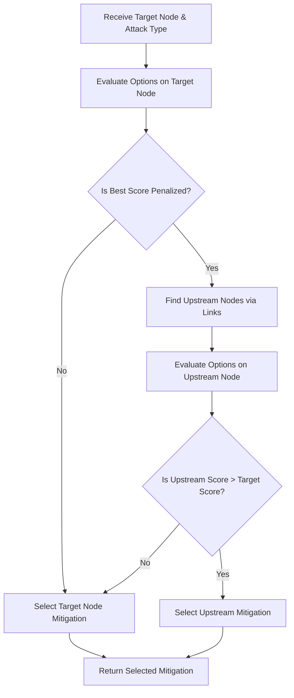

# PETA (JSON-Only Prototype)

The PETA prototype has been modernized from an XML-centric script into a pure JSON-based threat modeling service. It now supports multiple attack types and complex network topologies natively.

## Core Features

- **Pure JSON Pipeline**: All inputs and outputs are now JSON. XML generation logic and legacy files have been completely removed.
- **Dynamic Attack Mapping**: Uses `attack_mapping.json` to lookup MITRE ATT&CK IDs (e.g., SQL Injection -> T1190) and mitigation IDs.
- **Context-Aware Mitigations & Scoring**: PETA evaluates multiple mitigation options based on target context (e.g. Criticality). A dedicated `scoring_engine.py` selects the most effective, least disruptive action.
- **Eclipse Ditto Integration**: Integrates directly with Eclipse Ditto Digital Twin formats using an `adaptor.py` to ingest "Things" and export Desired State patches.
- **KB Integration**: Queries the Knowledge Base for mitigations based on the detected attack type.

## Supported Attack Types

PETA currently supports mapping and contextual mitigations for the following attack types:

1.  **Denial of Service (DoS / SYN_Flood)**: Specialized for Network Denial of Service (T1498.002).
2.  **Port_Scan**: Specialized for Reconnaissance: Active Scanning (T1595).
3.  **Brute_Force**: Specialized for Brute Force: Password Cracking (T1110.002).
4.  **SQL Injection**: Specialized for Exploit Public-Facing Application (T1110).

## SDT-Topo Workflow (In-Lab Demo, SDT-based)

The **SDT-Topo** workflow is designed for in-lab demos where the **TAD (Threat Anomaly Detection)** system orchestrates real-time mitigation via its local `tad_adaptor.py`:



### Online Flow Steps:
1.  **Attack Generation**: TAD generates cyber attack information based on monitored events (ML Inference).
2.  **Topology Retrieval**: TAD uses **`tad_adaptor.py`** to fetch and convert the current topology state from the **SDT Service**.
3.  **Analysis Request**: TAD calls the PETA `/sdt-topo/` endpoint with the attack info and the converted topology.
4.  **Enforcement**: The result is translated into an SDT-specific patch by the local adaptor and pushed to the middleware.

## Cobalt-Topo Workflow (Cobalt Framework based)


### Key Components

| File | Responsibility |
| :--- | :--- |
| [adaptor.py](file:///home/abdul/DigitalTwin/TAD-PETA/PETA/adaptor.py) | **PETA Utility**: Contains helper functions for PETA-side JSON patching and format conversion. |
| [scoring_engine.py](file:///home/abdul/DigitalTwin/TAD-PETA/PETA/scoring_engine.py) | **Evaluation Logic**: Weighs mitigation `Effectiveness` vs `ImpactLevel` against node `Criticality`. |
| [main.py](file:///home/abdul/DigitalTwin/TAD-PETA/PETA/main.py) | **API Layer**: Exposes `/sdt-topo/` and `/cobalt-topo/` endpoints. |
| [threat_model.py](file:///home/abdul/DigitalTwin/TAD-PETA/PETA/threat_model.py) | **Modeling Layer**: Builds the JSON threat model standard dictionary. |
| [attack_mapping.json](file:///home/abdul/DigitalTwin/TAD-PETA/PETA/attack_mapping.json) | **Mapping**: Stores the relationship between TAD attack labels, MITRE ATT&CK standards, and multiple mitigation options. |

## Scoring Engine Upstream Analysis

The scoring engine dynamically evaluates mitigation options and traverses the network graph to find upstream targets if the target node is highly critical:



### How the Upstream Graph Traversal Works:
1. **Target Evaluation**: The engine first scores mitigations for the direct **Target Node** identified in the alert.
2. **Criticality Check**: It checks the target node's `Criticality`. If the node is highly critical (e.g., a core production database) and the best mitigation has a high disruptive `ImpactLevel` (like terminating all sessions), the overall score is heavily penalized.
3. **Link Traversal**: If the score is penalized, the engine parses the `Links` array in the topology to find **Upstream Nodes** (nodes where traffic flows *from* them *to* the target node).
4. **Upstream Evaluation**: It evaluates mitigation options for those upstream nodes (e.g., applying a WAF block rule on an upstream Frontend container instead of dropping the database).
5. **Score Comparison**: If mitigating on the less critical upstream node yields a higher overall safety score, the engine selects the upstream mitigation and automatically shifts the `Targeted_Asset` ID in the final output so the Digital Twin patch is applied to the correct upstream location.


## Project Structure

```text
PETA/
├── main.py              # API Layer (FastAPI)
├── threat_model.py      # Modeling Logic (JSON builder)
├── attack_mapping.json  # MITRE & Mitigation Mappings
├── config.json          # Service configurations
├── tests/               # Verification & test scripts
├── Dockerfile           # Deployment
└── docker-compose.yaml  # Deployment
```

## Usage Example

### Triggering the API

Submit a JSON payload representing a cyber attack and your network topology:

```bash
curl --location 'http://127.0.0.1:8000/sdt-topo/' \
--header 'Content-Type: application/json' \
--data '{
    "cyber_attack": {
        "type": "SQL_Injection",
        "targeted_asset": "upc.craax.resource:postgres-db-pod-01",
        "vector": {
            "attack_timestamp": "2024-06-01T12:00:00Z",
            "attack_location": "Internet"
        }
    },
    "organization_assets": {
        "topology": {
            "nodes": [
                {"id": "upc.craax.resource:web-frontend-pod-01", "name": "Frontend Web Server (Container)", "type": "Frontend", "ip": "10.244.1.5", "criticality": 8},
                {"id": "upc.craax.resource:postgres-db-pod-01", "name": "Primary Database (Pod)", "type": "Database", "ip": "10.244.2.10", "criticality": 10}
            ],
            "links": []
        }
    }
}'
```

### Triggering Cobalt-Topo (Offline)

Use the following to trigger the offline analysis using the `cobalt_topology.json` file:

```bash
curl --location 'http://127.0.0.1:8000/cobalt-topo/' \
--header 'Content-Type: application/json' \
--data '{
    "cyber_attack": {
        "type": "SQL_Injection",
        "targeted_asset": "nc-pod-ditto",
        "vector": {
            "attack_timestamp": "2024-06-01T12:00:00Z",
            "attack_location": "Internet"
        }
    }
}'
```


The system will generate a JSON threat model evaluated by the scoring engine. You can fetch the latest build:
```json
{
  "threat_model": {
    "id": "tm_8b2c65n3dr87345s54gd746b7h83t82k",
    "metadata": {
      "timestamp": "2024-06-01T12:00:00Z",
      "source": "Internet",
      "targeted_asset": "upc.craax.resource:postgres-db-pod-01"
    },
    "cyber_attack": {
      "type": "SQL_Injection",
      "mitre": {
        "name": "Exploit Public-Facing Application",
        "id": "T1190"
      }
    },
    "organization_assets": {
      "nodes": [...],
      "links": []
    },
    "control_action": {
      "mitigation_action": {
        "methods": [
          "Terminate Active DB Sessions from Affected Pod",
          "filter_network_traffic"
        ],
        "mitre_id": "M1050.3",
        "context_applied": "Database",
        "selected_mitigation": {
          "mitigation_id": "M1050.3",
          "description": "Terminate Active DB Sessions from Affected Pod",
          "action": "SELECT pg_terminate_backend(pid) FROM pg_stat_activity WHERE client_addr = '\''$POD_IP'\'';",
          "impact_level": "High",
          "effectiveness": "Medium",
          "_calculated_score": 90.0
        }
      }
    }
  }
}
```

This resulting JSON Threat Model can then be passed to `adaptor.py`'s `peta_to_ditto_patch()` function to generate a payload to update the Eclipse Ditto Digital Twin desired state automatically:
```json
[
  {
    "targetThingId": "upc.craax.resource:postgres-db-pod-01",
    "patch": [
      {
        "op": "add",
        "path": "/features/security_controls/desiredProperties/enforced_mitigation",
        "value": {
          "mitigation_id": "M1050.3",
          "description": "Terminate Active DB Sessions from Affected Pod",
          "implementation_command": "SELECT pg_terminate_backend(pid) FROM pg_stat_activity WHERE client_addr = '$POD_IP';",
          "timestamp": "2024-06-01T12:00:00Z"
        }
      }
    ]
  }
]
```

### Fetching the Schema
The system will generate a JSON threat model. You can fetch the latest build:
```bash
curl --location --request GET 'http://127.0.0.1:8000/fetch-json-schema'
```
