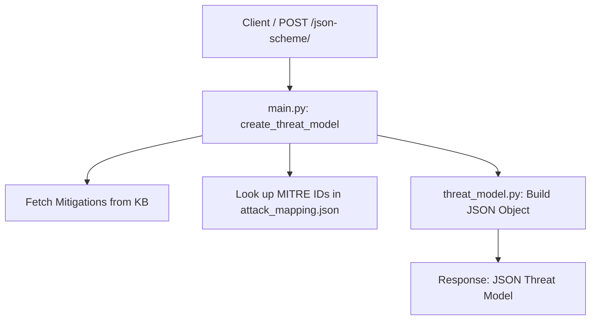

# PETA (JSON-Only Prototype)

The PETA prototype has been modernized from an XML-centric script into a pure JSON-based threat modeling service. It now supports multiple attack types and complex network topologies natively.

## Core Features

- **Pure JSON Pipeline**: All inputs and outputs are now JSON. XML generation logic and legacy files have been completely removed.
- **Dynamic Attack Mapping**: Uses `attack_mapping.json` to lookup MITRE ATT&CK IDs (e.g., SQL Injection -> T1190) and mitigation IDs.
- **Topology-Aware Modeling**: The system processes a graph of **Nodes** and **Links**, representing them in the final threat model rather than modeling a single isolated asset.
- **Context-Aware Mitigations**: By identifying the `Target_Asset_Id` in the attack payload, the system provides specialized mitigations based on the asset's type (e.g., "WAF Rules" for Web Servers vs. "Session Termination" for Databases).
- **KB Integration**: Queries the Knowledge Base for mitigations based on the detected attack type.

## Supported Attack Types

PETA currently supports mapping and contextual mitigations for the following attack types:

1.  **Denial of Service (DoS)**: Specialized for Network Denial of Service (T1498.002).
2.  **SQL Injection**: Specialized for Exploit Public-Facing Application (T1190).

## Architecture and Flow

The application uses a streamlined JSON flow:



### Key Components

| File | Responsibility |
| :--- | :--- |
| [main.py](file:///home/abdul/DigitalTwin/TAD-PETA/PETA/main.py) | **API Layer**: Exposes `/json-scheme/` and `/fetch-json-schema`. |
| [threat_model.py](file:///home/abdul/DigitalTwin/TAD-PETA/PETA/threat_model.py) | **Modeling Layer**: Builds the threat model as a standard dictionary. |
| [attack_mapping.json](file:///home/abdul/DigitalTwin/TAD-PETA/PETA/attack_mapping.json) | **Mapping**: Stores the relationship between attack names and MITRE standards. |

## Project Structure

```text
PETA/
├── main.py              # API Layer (FastAPI)
├── threat_model.py      # Modeling Logic (JSON builder)
├── attack_mapping.json  # MITRE & Mitigation Mappings
├── config.json          # Service configurations
├── tests/               # Verification & test scripts
├── Dockerfile           # Deployment
└── docker-compose.yaml  # Deployment
```

## Usage Example

### Triggering the API

Submit a JSON payload representing a cyber attack and your network topology:

```bash
curl --location 'http://127.0.0.1:8000/json-scheme/' \
--header 'Content-Type: application/json' \
--data '{
    "CyberAttack": {
        "Type": "SQL_Injection",
        "Target_Asset_Id": "node-db-01",
        "Vector": {
            "attack_timestamp": "2024-04-28T19:21:44.613Z",
            "attack_location": "Internet"
        }
    },
    "OrganizationAssets": {
        "Topology": {
            "Nodes": [
                {"Id": "node-web-01", "Name": "Front", "Type": "Frontend", "IP": "10.0.0.1"},
                {"Id": "node-db-01", "Name": "DB", "Type": "Database", "IP": "10.0.0.2"}
            ],
            "Links": [
                {"Source": "node-web-01", "Target": "node-db-01", "Type": "VLAN"}
            ]
        }
    }
}'
```

The system will generate a JSON threat model. You can fetch the latest build:
```bash
{
  "ThreatModel": {
    "Id": "tm_8b2c65n3dr87345s54gd746b7h83t82k",
    "Metadata": {
      "Timestamp": "2024-04-28T19:21:44.613Z",
      "Source": "Internet",
      "Targeted_Asset": "node-db-01"
    },
    "CyberAttack": {
      "Type": "SQL_Injection",
      "MITRE": {
        "Name": "Exploit Public-Facing Application",
        "ID": "T1190"
      }
    },
    "OrganizationAssets": {
      "Nodes": [
        {
          "Id": "node-web-01",
          "Name": "Front",
          "Type": "Frontend",
          "IP": "10.0.0.1"
        },
        {
          "Id": "node-db-01",
          "Name": "DB",
          "Type": "Database",
          "IP": "10.0.0.2"
        }
      ],
      "Links": [
        {
          "Source": "node-web-01",
          "Target": "node-db-01",
          "Type": "VLAN"
        }
      ]
    },
    "ControlAction": {
      "MitigationAction": {
        "Methods": [
          "Terminate SQL Session & Isolate DB Link",
          "filter_network_traffic"
        ],
        "MITRE_ID": "M1050",
        "Context_Applied": "Database"
      }
    }
  }
}
```

### Fetching the Schema
The system will generate a JSON threat model. You can fetch the latest build:
```bash
curl --location --request GET 'http://127.0.0.1:8000/fetch-json-schema'
```
