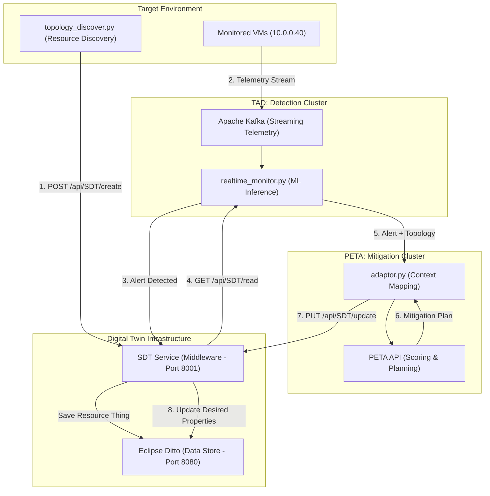

# Digital Twin Security Pipeline (TAD & PETA)

This repository contains a unified, automated security pipeline for Eclipse Ditto Digital Twins, integrating **Threat Anomaly Detection (TAD)** and **Proactive Evaluation of Threat Actions (PETA)** via a standardized **Security Digital Twin (SDT) Service** middleware.

## 🚀 The Integrated Architecture

The pipeline operates in a real-time feedback loop, moving from live discovery to automated remediation.

## 🛠️ Key Components

### 1. Dynamic Topology Discovery (`VM_Agents/`)
*   **[topology_discover.py](file:///home/abdul/DigitalTwin/TAD-PETA/VM_Agents/topology_discover.py)**: Scans VM network state and registers it as a **`Resource`** thing in the SDT Service. 
*   **Feature Mapping**: Includes a placeholder `security_controls` feature in the Digital Twin, prepared for incoming automated patches.

### 2. Real-time Monitoring & Orchestration (`TAD/`)
*   **[realtime_monitor.py](file:///home/abdul/DigitalTwin/TAD-PETA/TAD/scripts/realtime_monitor.py)**: The central brain. It performs ML inference on incoming telemetry and orchestrates the remediation loop via the SDT Service.
*   **SDT Interaction**: Standardizes all GET/PUT operations to port **8001**, ensuring the `Resource` category is maintained across the pipeline.

### 3. Smart Mitigation Planning (`PETA/`)
*   **[PETA API](file:///home/abdul/DigitalTwin/TAD-PETA/PETA/main.py)**: Receives alerts and identifies the optimal mitigation through its scoring engine.
*   **Desired State Mapping**: Mitigations are converted into **`desiredProperties`** for the `security_controls` feature, signaling a required change in the physical asset's configuration.

---

## 📈 Future Roadmap

Based on our **[Future Improvements Proposal](file:///home/abdul/.gemini/antigravity/brain/c44c4927-9cdd-4b88-8e43-4d93f49f0da0/improvement_proposal.md)**:

1.  **Streaming Ingestion**: Fully transition from batch SCP fetching to high-throughput **Apache Kafka** streams for sub-second detection latency.
2.  **Dynamic Labeling**: Integrate **Zeek** and **Suricata** logs to automatically label and retrain ML models based on passive signature matches.
3.  **Reinforcement Learning**: Evolve the PETA scoring engine into an RL agent that learns the most effective mitigations for specific topologies over time.
4.  **Autoencoders**: Implement unsupervised learning to detect "Zero-Day" anomalies that deviate from established behavioral baselines.

---

## 📖 Component Guides

*   **[TAD Guide](./TAD/README.md)**: Details on data collection, feature extraction, and ML training.
*   **[PETA Guide](./PETA/README.md)**: Details on the scoring engine, graph traversal, and mitigation mapping.
*   **[Walkthrough Artifact](file:///home/abdul/.gemini/antigravity/brain/c44c4927-9cdd-4b88-8e43-4d93f49f0da0/walkthrough.md)**: A summary of the latest integration verification.