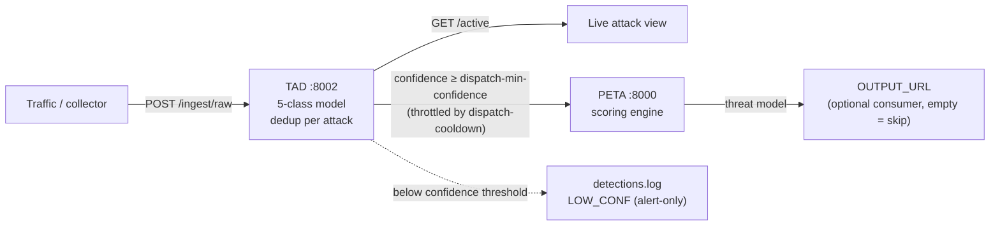

# TAD → PETA workflow (standalone)

Detects attacks in network traffic (TAD) and selects a mitigation for the affected
asset (PETA). **SDT / Eclipse Ditto are not part of this workflow** — the topology is
read from a local file and the finished threat model is POSTed to an output endpoint.

| | |
|---|---|
| TAD ingest | `POST http://<host>:8002/ingest/raw` |
| Live attack view | `GET http://<host>:8002/active` |
| PETA | `:8000` (called by TAD, not directly) |
| **OUTPUT_URL** | **empty by default → delivery skipped. Set it to POST threat models to a consumer.** |

---

## Architecture



TAD scores every packet but only calls PETA once per `(attack_type, target)` per
cooldown window — see *Dispatch de-duplication* below. Detections below
`--dispatch-min-confidence` are logged but never dispatched — see *Confidence gate*.
No SDT / Eclipse Ditto in this loop: topology comes from a local file, and delivery
of the finished threat model is a plain optional `POST` to `OUTPUT_URL`.

---

## 1. Install (Python 3.10+)

```bash
cd TAD_PETA
python3 -m venv .venv && source .venv/bin/activate
pip install -r requirements.txt
```

TAD needs `joblib` + `scikit-learn` to load the model — a bare system `python3`
without them makes TAD exit at startup with `ModuleNotFoundError: joblib`.
`run_all.sh` runs both services under `$PY` (default `/home/sdt/gnn_env/bin/python`).
Point it at your own interpreter if different:

```bash
PY=/path/to/venv/bin/python ./run_all.sh
```

## 2. Run everything

```bash
./run_all.sh
# if you get "Permission denied" (some unzip tools drop the exec bit):
bash run_all.sh
# point it at a real consumer (default is empty = skip delivery):
OUTPUT_URL=http://my-consumer/mitigation ./run_all.sh
```

Starts PETA (:8000) then TAD (:8002). Ctrl-C stops both.

**Each run is saved to its own folder** — `logs/<timestamp>/`, with `logs/latest`
pointing at the newest — so runs never overwrite or mix:

| file | what |
|---|---|
| `server.log` | **raw** — everything TAD prints (batches, dispatch, `[OUT]` delivery, errors) |
| `detections.log` | **TAD** — one line per detection (`pkt=`/`lag=` fields, see below) |
| `peta.log` | **PETA** — PETA's own output |

Override the location with `LOG_ROOT=/var/log/tad ./run_all.sh`.

**Watchdog (on by default).** `run_all.sh` supervises both services and restarts
whichever dies (PETA crashing while TAD stayed up was a recurring failure). Disable
with `WATCHDOG=0 ./run_all.sh`; tune the poll interval with `CHECK_EVERY=5`.

## 3. Send traffic

```bash
python3 send_test_traffic.py                 # bundled 1000-packet sample
python3 send_test_traffic.py --all           # full 86,845-packet capture
python3 send_test_traffic.py --url http://10.163.1.126:8002/ingest/raw
```

Expected on the sample: ~870 attacks detected, all `stress_test`. With dispatch enabled
these collapse to a handful of PETA calls (one per `(attack_type, target)` per cooldown);
the rest are reported as `suppressed`. See *Dispatch de-duplication* below.

---

## Sending traffic from your own collector

`POST http://<host>:8002/ingest/raw` — JSON records using the capture's field names.
**No CSV file involved**; this is the live-stream route.

```json
{"rows": [
  {"packet_time_utc": "2026-06-15T18:36:46.495822",
   "src_ip": "10.163.1.105", "src_port": 33796,
   "dst_ip": "10.163.1.204", "dst_port": 111,
   "protocol": "tcp", "tcp_flags": "S",
   "packet_length": 60, "ip_ttl": 38}
]}
```

Those 9 fields are all that is needed — TAD derives the model's 30 features internally.
Lowercase `protocol` and letter `tcp_flags` (`S`, `PA`) are fine; a `label` field is
ignored. A tshark-style schema (`timestamp`, `frame_len`, hex flags) also works on the
same route (auto-detected).

**Three rules for the sender**

1. **~300–500 rows per request** (or flush every ~200 ms). One row per request drops
   to ~6 pkt/s; a batch scores at ~3,800 pkt/s. Hard cap 10,000 rows → `HTTP 413`.
2. **Keep capture order.** Detection is stateful — 9 of the 30 features are rolling
   statistics over each sender's last 20 packets. Shuffled input drops DoS recall
   from 96% → 64%.
3. Only if you run **multiple TAD instances**: route by `hash(src_ip)`, never
   round-robin. Irrelevant for a single instance.

The response reports `dispatched` (PETA calls made) and `suppressed` (attack packets
folded into an already-active attack — see *Dispatch de-duplication* below). A scan or
DDoS shows a large `suppressed` and a tiny `dispatched`; that is correct.

---

## What TAD detects → what PETA does

| TAD label | PETA attack type | example mitigation (Ubuntu) |
|---|---|---|
| `stress_test` | `Denial_of_Service` | `nft add rule inet filter input ip saddr $SOURCE_IP drop` |
| `nmap_scan` | `Port_Scan` | `fail2ban-client set portscan banip $SOURCE_IP` |
| `hydra_bruteforce` | `Brute_Force` | `fail2ban-client set sshd banip $SOURCE_IP` |
| `post_exploitation` | `Host_Compromise` | `ufw deny out to $SOURCE_IP` |
| `benign` | — | ignored |

PETA picks the mitigation by `effectiveness` vs `impact × criticality`, and can apply it
**upstream** — e.g. a DoS on `mysql` (criticality 9) is mitigated at the frontend rather
than taking the database down.

---

## Editing the testbed topology

`PETA/ncsrd_topology_peta.json` holds the 18 target VMs. Do **not** hand-edit it —
change `TARGET_HOSTS` / `LINKS` in `PETA/build_ncsrd_config.py` and regenerate:

```bash
python3 PETA/build_ncsrd_config.py
```

That regenerates the topology **and** `attack_mapping.json`, and validates that every
(node × attack) pair resolves to a real mitigation — currently **108/108**. This matters:
`scoring_engine` returns `[]` for an unknown asset context, so a node with an unmapped
`type` would *silently* get no mitigation. The generator fails loudly instead.

Contexts: `Frontend`, `Database`, `Compute`, `Identity`, `Security`.

---

## Configuration

| flag (on `tad_api.py`) | default | purpose |
|---|---|---|
| `--output-url` | empty | where the threat model is POSTed; empty = **skip delivery** (see note) |
| `--dispatch-cooldown` | 30 | min seconds between PETA calls for the same `(attack_type, target)` — collapses scan/DDoS floods |
| `--dispatch-min-confidence` | 0.7 | don't fire a mitigation below this confidence; detection still logged as `LOW_CONF` (alert-only) |
| `--active-timeout` | 60 | seconds of silence before an attack drops off `/active` (its end time) |
| `--topology-file` | `PETA/ncsrd_topology_peta.json` | asset topology (SDT not used) |
| `--dispatch` | off | actually call PETA; without it, detections are logged only |
| `--log-file` | — | write every detection to a rotating file |
| `--log-format` | `text` | `jsonl` for SIEM ingest |
| `--quiet-console` | off | one summary line per batch instead of per detection |
| `--max-batch` | 10000 | reject bigger requests (413) |
| `--max-sources` | 50000 | LRU cap on per-source state (spoofed-flood protection) |
| `--idle-timeout` | 300 | evict sources idle this long |

> **`--output-url` / `OUTPUT_URL`.** Delivery is inline, per attack. Pointing it at a
> host that isn't listening costs a connect timeout on *every* detection and stalls
> `/ingest/raw`. Leave it empty until a real consumer exists (also `TAD_OUTPUT_URL` env,
> and `TAD_OUTPUT_TIMEOUT`, default 2 s).

## Endpoints

| route | purpose |
|---|---|
| `POST /ingest/raw` | **send traffic here** |
| `GET /ingest/raw` | liveness probe (returns 200 + usage; POST is the real route) |
| `POST /ingest` | pre-normalized packets (epoch float, `frame_len`, uppercase protocol) |
| `GET /active` | **attacks happening now** — one row per `(attack_type, target)`, deduped |
| `GET /health` | model, classes, active sources, batch limits, cooldown settings |
| `GET /stats` | counters incl. `dispatched` / `suppressed` |
| `POST /reset` | clear per-source state and the live-attack table |

`GET /active` is the real-time view — each entry carries `started`, `ongoing_seconds`,
`idle_seconds`, `packets`, `sources`, and the chosen `mitigation`. An entry disappears
after `--active-timeout` seconds of silence.

---

## Verify the install

```bash
export PYTHONPATH=$PWD/TAD/scripts
# live feature code == training feature code (must print PASS)
python3 TAD/scripts/newdataset_inference.py \
    --model TAD/models/multiclass/hgb_newdataset_5class.joblib \
    --csv TAD/data/labeled_packets_deep.csv --validate

# model quality on the full capture
python3 TAD/scripts/newdataset_inference.py \
    --model TAD/models/multiclass/hgb_newdataset_5class.joblib \
    --csv TAD/data/labeled_packets_deep.csv --limit 0
```

Expect `PASS ✓` and overall accuracy ≈ 0.9999.

---

## Dispatch de-duplication (cooldown)

TAD scores **every packet**, but dispatches to PETA at most **once per
`(attack_type, target)` per `--dispatch-cooldown` seconds** (default 30). Without this,
a per-packet dispatch turns an 18-second, 24k-packet nmap scan into 24k identical PETA
calls and TAD falls minutes behind; the folded packets are counted as `suppressed`.

Effect on the full 86,845-packet capture (incl. a 28,771-packet DDoS): **29,841 attacks
→ 8 PETA calls**, worst batch **~3 s** (under a 10 s client read timeout). Detection is
unchanged — only how often PETA is called. Watch it live with `GET /active`.

A new `(attack_type, target)`, a new victim, or the same attack after the cooldown all
dispatch immediately — only exact repeats within the window are folded.

### Victim resolution & external targets

TAD picks the victim by attack **direction**: scan / brute-force / DoS → the
**destination**; `Host_Compromise` (reverse shell / post-exploitation) → the
compromised **internal** host (usually the source, since it dials out to the
attacker). If the resolved victim isn't a managed asset in the topology
(external IP, or an unlisted host), it is **alerted, not mitigated** — logged as
`ALERT_EXTERNAL` and counted as `external` — so PETA only ever acts on machines
you own. It no longer silently blames the first node in the topology file.

## Confidence gate

Mitigations are real (ban IPs, drop traffic), so TAD will not fire one on a shaky
prediction. Below `--dispatch-min-confidence` (default 0.7) an attack is still detected
and logged — as `LOW_CONF` — but **not** dispatched to PETA. The response and `/stats`
report the count as `low_confidence`.

This matters on **live** traffic: the model was trained on a controlled capture and is
near-certain there (~1.0), but on real traffic ~40% of detections drop below 0.7
(distribution shift). Without the gate, a 0.46-confidence "DDoS" toward a legitimate
service (e.g. a CDN) would get that service blocked. Raise the threshold to act only on
high-certainty detections; lower it (e.g. 0) to dispatch everything as before.

## Detection log format

`detections.log` lines carry both timestamps:

```
<processed_ts> DISPATCHED nmap_scan conf=1.000 src=… dst=… pkt=<capture_ts> lag=<s> peta=Port_Scan
```

`pkt=` is when the packet was captured; `lag=` is `processed − captured`. On **live**
traffic `lag` ≈ 0 and rising lag is your early warning that TAD is falling behind. On a
**replayed historical capture** `lag` is just the age of the capture — ignore it there.
`--log-format jsonl` emits the same as `pkt_time` / `lag_s` fields.

## Notes / known issues

- **Directory layout matters.** TAD reads `../../PETA/attack_mapping.json` and
  `../../PETA/ncsrd_topology_peta.json` relative to `TAD/scripts/`. Keep `TAD/` and
  `PETA/` as siblings.
- **Mitigation commands are untested on live hosts.** Correct Ubuntu syntax, but never
  executed. Some are destructive (`ufw default deny outgoing`, `kubectl drain`). The
  workflow only *delivers* them to `OUTPUT_URL` — nothing is executed by TAD or PETA.
- **Don't let the collector capture TAD's own ingest traffic**, or TAD will classify its
  own telemetry as a flood: `tcpdump ... and not (host <tad-host> and port 8002)`.
- `realtime_monitor_v2.py` is the CSV-tailing alternative to the API. Use it, **not**
  `realtime_monitor.py` — the original builds only 10 features and fails silently with
  these 30-feature models. Both originals are included unmodified for reference.
