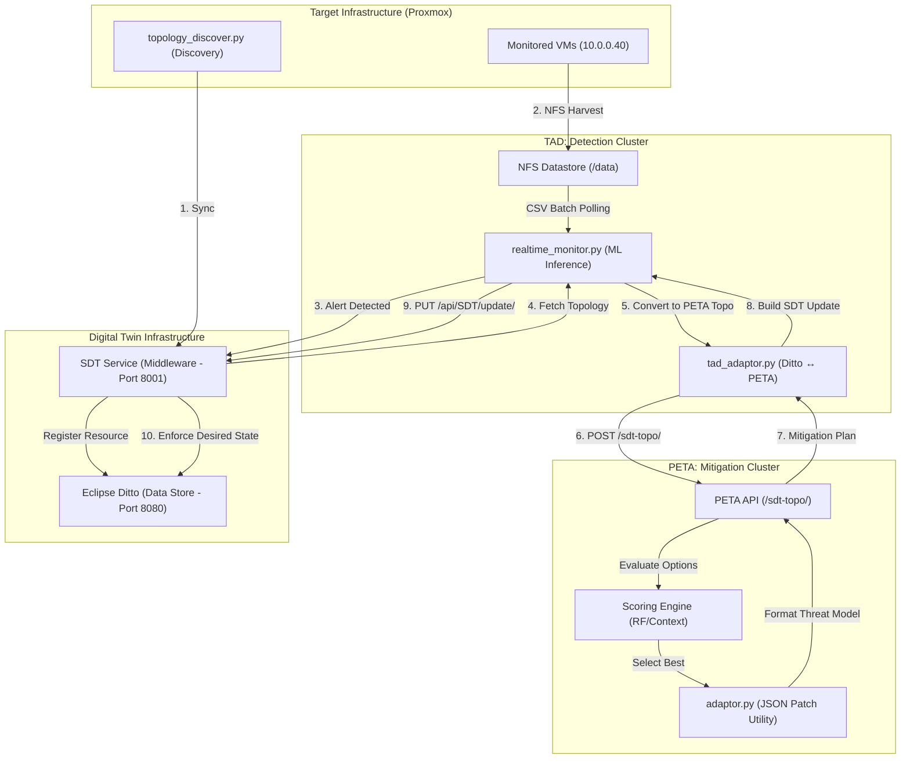

# Digital Twin Security Pipeline (TAD & PETA)

This repository contains a unified, automated security pipeline for Eclipse Ditto Digital Twins, integrating **Tool for Attack detection (TAD)** and **Predictive Tool for Attack Impact Estimation (PETA)** via a standardized **Security Digital Twin (SDT) Service** middleware.

---

## 🎮 Demonstration Workflows

The pipeline supports two primary demonstration scenarios:

### 1. Online Real-time Remediation (SDT-Topo)
**Goal**: Live detection and automated enforcement on a running Digital Twin.
- **Topology**: Dynamically fetched from **Eclipse Ditto** via the SDT Service.
- **Enforcement**: Automated mitigation patches are pushed back to the Digital Twin's `desiredProperties`.
- **Primary Endpoint**: `POST /sdt-topo/`

### 2. Offline Forensic Analysis (Cobalt-Topo)
**Goal**: Forensic evaluation of attacks against a static, pre-defined topology.
- **Topology**: Loaded from a local `cobalt_topology.json` file.
- **Enforcement**: Results are logged to a file for investigation; no changes are made to the live system.
- **Primary Endpoint**: `POST /cobalt-topo/`

---

## 🚀 Integrated Architecture (In-Lab demo)

The online pipeline operates in a real-time feedback loop, moving from live discovery to automated remediation using a pure JSON data flow.

---

## 🛠️ Key Components

### 1. Dynamic Topology Discovery (`VM_Agents/`)
*   **[topology_discover.py](file:///home/abdul/DigitalTwin/TAD-PETA/VM_Agents/topology_discover.py)**: Scans active network connections via `psutil` to deduce node roles and linkages.
*   **Security Controls**: Automatically initializes the `security_controls` feature in the Digital Twin.

### 2. Real-time Monitoring & Orchestration (`TAD/`)
*   **[realtime_monitor.py](file:///home/abdul/DigitalTwin/TAD-PETA/TAD/scripts/realtime_monitor.py)**: The central orchestrator. It performs multi-class ML inference (DoS, Port Scan, Brute Force) on collected CSV data and manages the remediation loop.
*   **[tad_adaptor.py](file:///home/abdul/DigitalTwin/TAD-PETA/TAD/scripts/tad_adaptor.py)**: The local data bridge that translates Ditto "Things" into PETA topologies and threat models into enforced state patches.
*   **Unit Tests**: Located in `TAD/tests/`. Run using `pytest TAD/tests/ -v` to verify the automated pipeline logic.

**Test Coverage Tracking (TAD)**
| Module | Description | Coverage | Status |
| :--- | :--- | :--- | :--- |
| `tad_adaptor.py` | Verifies Ditto-to-PETA node conversion and SDT JSON patch construction. | 94% | Passing ✅ |
| `realtime_monitor.py` | Validates CSV stream ingestion, ML model inference, and API triggering logic. | 58% | Passing ✅ |

### 3. Smart Mitigation Planning (`PETA/`)
*   **[PETA API](/PETA/main.py)**: A JSON-only threat modeling service. Its scoring engine evaluates mitigations based on **Effectiveness**, **Impact**, and host **Criticality**.
*   **Unit Tests**: Located in `PETA/tests/`. Run using `pytest PETA/tests/ -v` to verify the automated pipeline logic. integrated into the GitHub Actions CI/CD pipeline.

**Test Coverage Tracking (PETA)**
| Module | Description | Coverage | Status |
| :--- | :--- | :--- | :--- |
| `adaptor.py` | Validates translation of Threat Models into enforced Eclipse Ditto state patches. | 100% | Passing ✅ |
| `scoring_engine.py` | Checks metric evaluations, criticality penalties, and dynamic upstream graph traversal. | 94% | Passing ✅ |
| `threat_model.py` | Ensures correct JSON structure assembly across various attack vectors and contexts. | 96% | Passing ✅ |
| `main.py` (API Layer) | Simulates full HTTP payloads ensuring end-to-end REST API processing. | 0% | Needs E2E Integration Tests ⚠️ |

---

## 📖 Component Guides

*   **[TAD Guide](./TAD/README.md)**: Details on data collection, feature extraction, and ML training.
*   **[PETA Guide](./PETA/README.md)**: Details on the scoring engine, graph traversal, and mitigation mapping.

