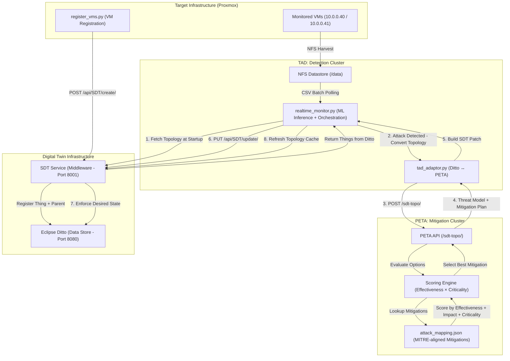

# Digital Twin Security Pipeline (TAD & PETA)

This repository contains a unified, automated security pipeline for Eclipse Ditto Digital Twins, integrating **Tool for Attack Detection (TAD)** and **Predictive Tool for Attack Impact Estimation (PETA)** via a standardized **Security Digital Twin (SDT) Service** middleware.

---

## Demonstration Workflows

The pipeline supports two primary demonstration scenarios:

### 1. Online Real-time Remediation (SDT-Topo)
**Goal**: Live detection and automated enforcement on a running Digital Twin.
- **Topology**: Dynamically fetched from **Eclipse Ditto** via the SDT Service at startup and refreshed after each successful mitigation.
- **Enforcement**: Automated mitigation patches are pushed back to the Digital Twin's `security` feature properties.
- **Primary Endpoint**: `POST /sdt-topo/`

### 2. Offline Forensic Analysis (Cobalt-Topo)
**Goal**: Forensic evaluation of attacks against a static, pre-defined topology.
- **Topology**: Loaded from a local `cobalt_topology.json` file.
- **Enforcement**: Results are logged to a file for investigation; no changes are made to the live system.
- **Primary Endpoint**: `POST /cobalt-topo/`

---

## Integrated Architecture (In-Lab Demo)

The online pipeline operates in a real-time feedback loop, moving from live VM registration to automated remediation with topology state refresh after each mitigation.

---

## Key Components

### 1. VM Registration (`VM_Agents/`)
- **[register_vms.py](./VM_Agents/register_vms.py)**: Registers lab VMs into Eclipse Ditto via the SDT Service. Each VM is created as a child thing under a shared parent (keyed by `toe_id`). Category and `toe_id` are passed both as query parameters (for thingId generation) and in the payload attributes (for stored state).

### 2. Real-time Monitoring & Orchestration (`TAD/`)
- **[realtime_monitor.py](./TAD/scripts/realtime_monitor.py)**: Central orchestrator. Performs multi-class ML inference (DoS, Port Scan, Brute Force, Benign) on CSV traffic data and drives the full remediation loop. Key behaviours:
  - Topology is fetched **once at startup** from SDT and cached in memory.
  - After each successful mitigation patch, the topology cache is **automatically refreshed** from SDT so the next attack sees the updated Digital Twin state (e.g. applied mitigations, changed security status).
  - Logs both the **actual CSV label** and the **model prediction** per row so false negatives are visible.
- **[tad_adaptor.py](./TAD/scripts/tad_adaptor.py)**: Data bridge that translates Ditto Things into PETA topology format and converts PETA threat model responses into SDT security patch payloads.

**Test Coverage (TAD)**
| Module | Description | Coverage | Status |
| :--- | :--- | :--- | :--- |
| `tad_adaptor.py` | Ditto-to-PETA conversion and SDT JSON patch construction | 94% | Passing |
| `realtime_monitor.py` | CSV stream ingestion, ML inference, and API triggering | 58% | Passing |

### 3. Smart Mitigation Planning (`PETA/`)
- **[PETA API](./PETA/main.py)**: JSON-only threat modelling service. Receives an attack type and topology, scores available mitigations, and returns the best mitigation plan as a structured threat model.
- **[scoring_engine.py](./PETA/scoring_engine.py)**: Scores each candidate mitigation using:
  - `effectiveness` (Low=10, Medium=50, High=90, Critical=100)
  - `impact_level` — penalises high-disruption actions on critical nodes
  - `criticality` of the target node (1–10 scale)
  - **Upstream graph traversal**: if the best score on the target node is poor, checks upstream nodes (e.g. WAF in front of DB) for a less disruptive alternative.
- **[attack_mapping.json](./PETA/attack_mapping.json)**: MITRE ATT&CK-aligned mitigation catalogue. Each attack type (`Brute_Force`, `Denial_of_Service`, `Port_Scan`, `SYN_Flood`, `SQL_Injection`) defines multiple mitigations per asset context (`Frontend`, `Database`), enabling the scoring engine to compare and select the best option rather than returning the only available one.

**Test Coverage (PETA)**
| Module | Description | Coverage | Status |
| :--- | :--- | :--- | :--- |
| `adaptor.py` | Threat model to Ditto state patch translation | 100% | Passing |
| `scoring_engine.py` | Metric evaluation, criticality penalties, upstream traversal | 94% | Passing |
| `threat_model.py` | JSON structure assembly across attack vectors | 96% | Passing |
| `main.py` | End-to-end REST API processing | 0% | Needs E2E Integration Tests |

---

## How the Topology Feedback Loop Works

A key design property of this pipeline is that the Digital Twin acts as **shared state** between detection and mitigation:

1. VMs are registered in Ditto with a `security` feature (`status`, `last_attack`, `mitigation_applied`).
2. When an attack is detected, `realtime_monitor.py` fetches the current topology (including security state) and sends it to PETA.
3. PETA selects the best mitigation considering the asset type and criticality.
4. The mitigation patch is written back to Ditto via SDT — updating `security.status`, `security.last_attack`, and `security.mitigation_applied`.
5. The topology cache in `realtime_monitor.py` is **immediately refreshed** from SDT after a successful patch.
6. The next attack against the same VM will include the applied mitigation in the topology sent to PETA, allowing it to reason about the current protection state.

---

## Component Guides

- **[TAD Guide](./TAD/README.md)**: Data collection, feature extraction, and ML model training.
- **[PETA Guide](./PETA/README.md)**: Scoring engine, graph traversal, and mitigation mapping.

---

This project has received funding from the European Union’s Horizon 2020 research and innovation programme under grant agreement No. 101119602.

